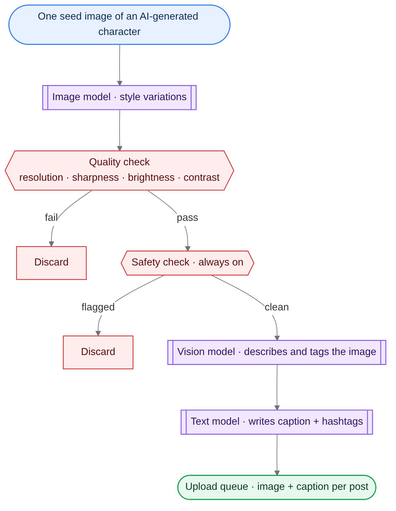
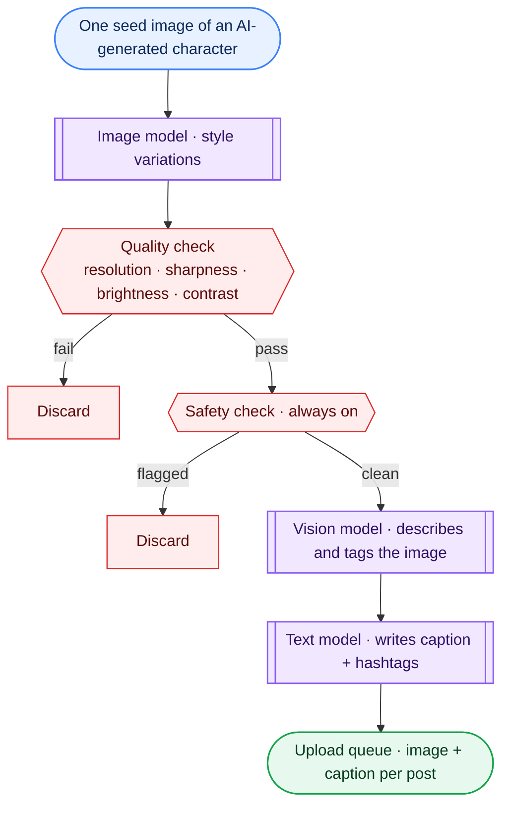

# AI Character Content Pipeline

> 📘 New here? Start with **[READ_THIS_OVERVIEW.md](READ_THIS_OVERVIEW.md)** for a plain-English walkthrough.

Turns one image of an AI-generated character into a vetted, captioned batch of social posts — with quality and safety checks built in.

## Workflow



> **Diagram key:** blue = input · purple = AI model · grey = processing · amber = storage · red = safety / guard rail · green = output

<details><summary>Diagram source (renders on GitHub)</summary>


</details>

## What it does
- Generates several style variations of a seed character image.
- Drops anything blurry, too dark, too bright or low-contrast using measurable checks.
- Runs every image through a safety classifier that can't be turned off from the config.
- Describes each image with a local vision model, then writes platform-specific captions and hashtags.
- Exports a ready-to-review upload queue.

## What this project demonstrates
- Multi-model pipeline (image, vision, text)
- Automated quality gates
- Content-safety enforcement
- Local-first LLM use via Ollama

## Quick start
1. Install Ollama and pull `llava` and `qwen2.5:7b`.
2. `pip install -r requirements.txt`; set `STABILITY_API_KEY` in your environment for the variation step.
3. `python ai_character_pipeline.py`

## Project layout
```
ai_character_pipeline.py   ← all stages
```

## Notes
Built for fully AI-generated characters only.

## License
MIT — see [LICENSE](LICENSE).
